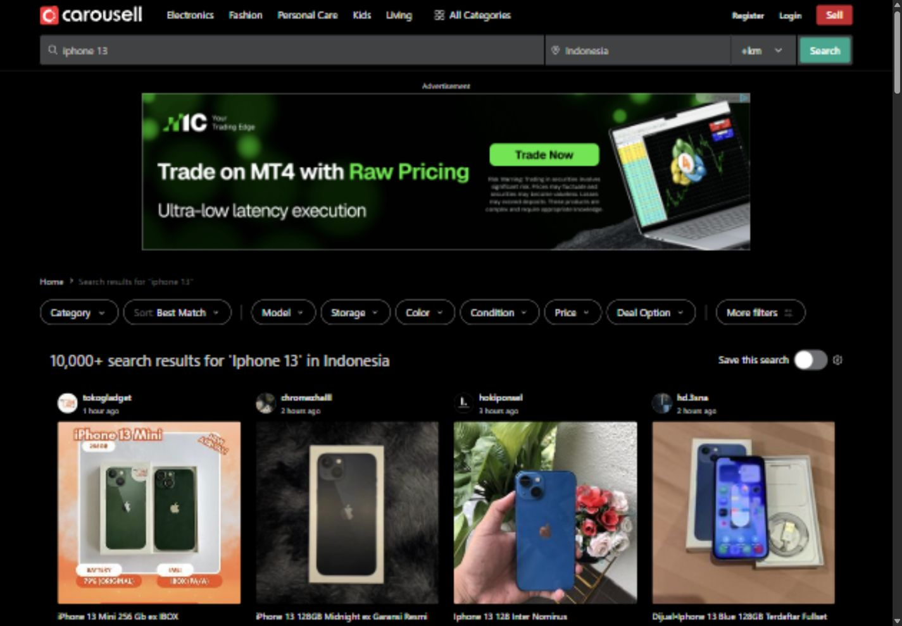
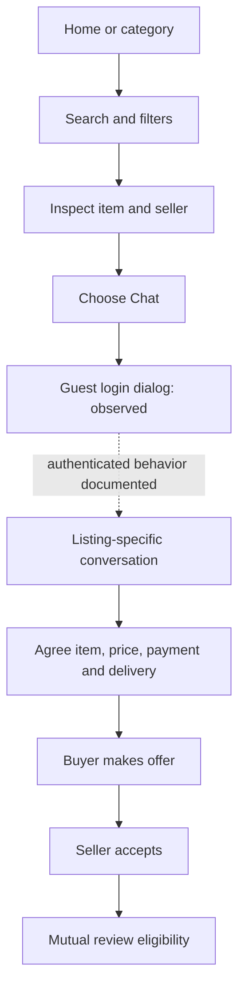
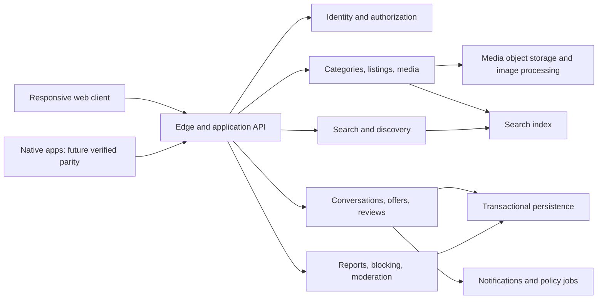

# Carousell Indonesia: reverse-engineering and reconstruction design

**Target:** https://id.carousell.com/  
**Research date:** 7 November 2026, Asia/Jakarta  
**Status:** Final report of the accessible public surface, with explicit residual unknowns  
**Method:** Local `reverse-engineer-anything` skill, REA runtime/static tools, direct browser observation, and official app-store/help sources

## 1. What this investigation establishes

Carousell Indonesia is a discovery and negotiation marketplace. The central journey is finding a listing, assessing the item and seller, starting a listing-specific conversation, agreeing on payment and delivery, making an offer, and obtaining seller acceptance. Accepted offers support mutual reviews. A conventional cart and integrated checkout are not established for Indonesia by this investigation.

The live website supports public browsing, category discovery, search, category-specific filters, product galleries, seller profiles, reviews, and a photo-first selling entry. Chat opens authentication for a guest. The observed offer panel requires sign-in. Both Android and iOS apps exist, and the Indonesian website links to their official stores. Native application screens, binaries, permissions and traffic were not inspected.

This is a reconstruction design grounded in observable behavior. It is **not a recovery of Carousell's private source, backend schema, infrastructure, or complete native application**. Sections marked **Proposed** are engineering designs for reproducing the evidenced experience; they are not claims about Carousell's implementation. Official help is marked **Documented** because it can lag production. Direct observations apply to the named session and sample, not every account, category or experiment.

### Evidence labels

| Label | Meaning | Appropriate use |
|---|---|---|
| O | Direct browser observation | Visible layout, control, URL or tested transition in this investigation |
| S | Static shipped-asset observation | Literal code, route, dependency marker, or conservative relationship in acquired public bundles |
| D | Official documentation/store declaration | Described product behavior, regional availability or store identity |
| I | Inference | Interpretation supported by evidence, with alternatives still possible |
| P | Proposed reconstruction | A deliberate implementation choice rather than a recovered fact |
| U | Unknown | Requires unavailable access, a device, credentials, or further evidence |

### Scope and operating constraints

The observed browser session was a guest on the Indonesia domain, displaying English text and a dark system theme. The web research service separately returned Indonesian page text. Country, language and theme must therefore be modeled independently. Desktop observation used a 1440 × 1000 CSS viewport; mobile observations used the initial 324 × 607 viewport and a 390 × 844 listing viewport. The temporary viewport override was reset.

No account was created, credentials entered, seller contacted, offer submitted, item published, file uploaded, app installed, or purchase made. Public reads and reversible search interactions were performed. A REA-launched isolated Chrome session encountered a Cloudflare challenge; the in-app browser loaded the actual marketplace normally. No challenge was solved or bypassed.

## 2. Investigation questions and coverage

| Question | Result | Evidence / remaining boundary |
|---|---|---|
| What is the target and does an app exist? | Answered | O01; A01–A02; Android and Indonesian iOS store pages |
| What can a guest discover and inspect? | Answered for sampled surfaces | O01–O08; home, category, search, listing, seller, review tabs |
| How does filtering change state? | Answered for price | O04; applied range changes URL, result heading and cards |
| What are the buying and trust loops? | Partly answered | O02–O03 plus A03, A06–A07; accepted-offer execution not tested |
| How does selling work? | Partly answered | O07 photo entry; A04–A05; post-upload form and publishing unobserved |
| How do mobile and desktop differ? | Partly answered | O01, O02, O09; two mobile sizes, one desktop size, dark theme only |
| Which client technologies and API candidates ship? | Partly answered | S01–S04; 43 bundles, 2,149,267 bytes; semantic limits retained |
| Which features actually apply to Indonesia? | Documented boundary established | A01–A17; do not import other-market checkout, AI or promotion assumptions |
| What are native app internals? | Unresolved | No official APK/IPA or running device session available |
| What is the backend implementation? | Unresolved | Proposed design only; no server code, database or privileged access |

## 3. Product model, actors and goals

**O/D:** A person can browse as a guest and use one account as both buyer and seller. Public inventory includes ordinary goods, fashion, electronics, collectibles, services, jobs, property and vehicles. A hard-coded universal goods form would not reproduce this breadth.

| Actor | Goal | Important product support |
|---|---|---|
| Guest | Assess supply and trust before joining | Public cards, search, detail, seller reputation; contextual sign-in |
| Buyer | Find a suitable item and agree a deal | Filters, likes, saved searches, chat, offers, reviews |
| Casual seller | Turn an item into an effective listing | Photos first, category-specific fields, delivery preferences, buyer conversations |
| Professional seller | Gain exposure and manage supply | Indonesia CarouBiz service; other seller tools require market verification |
| Moderator/support operator | Handle scams, prohibited material and disputes | Reports, reason/details collection, evidence access and support escalation; internal UI unknown |

**I:** The marketplace's conversion object is a qualified conversation and accepted offer, rather than a cart. Seller trust is part of item evaluation, not a separate destination. The homepage also combines editorial promotion, price reductions, recommendations, and SEO discovery.

## 4. Information architecture and routes

### 4.1 Observed route families

| Surface | Observed URL pattern | Notes |
|---|---|---|
| Home | `/` | Promotional banners, illustrated category rail, reduced-price rail, recommended feed |
| Category | `/categories/mobile-phones-338/` | Numeric category identity with readable slug; subcategory navigation |
| Nested category | `/categories/health-and-beauty-11/hair-care-307/` | Appeared in listing breadcrumb |
| Global search | `/search/iphone%2013` | Actual typed-search destination |
| Search within category | `/categories/mobile-phones-338/?search=...` | Search from category preserved category scope |
| SEO query landing | `/iphone-12/q/` and other `/<query>/q/` links | Linked from footer and item interlinks; not all followed |
| Listing | `/p/<readable-slug>-1469607528/` | Numeric listing identity; navigation adds attribution query fields |
| Seller | `/u/realand/` | Listings and Reviews tabs |
| Seller review deep link | `/u/realand/?tab=reviews` | Linked from item detail |
| Sell | `/sell?source=nav_bar` | Public photo-selection entry |
| Login / register | `/login/`, `/signup/` | Also accessible as a contextual login dialog |
| Recovery | `/forgot-password` | Link observed, recovery flow not exercised |
| Price-drop collection | `/see-all/?endpoint=...` | Encoded endpoint parameter observed; not treated as an API contract |
| Business campaign | `/caroubiz-indonesia-2025/l/` | Homepage banner destination; year in slug does not prove policy date |

**O:** Attribution parameters include `t-source`, `t-id`, `t-referrer_page_type`, `t-referrer_browse_type`, `t-referrer_request_id`, search query/source, sort and tap index. These are navigation metadata. Their presence does not establish a particular analytics event delivery or backend attribution pipeline.

**P:** Separate canonical navigation state from attribution. Canonical item links should remain usable without tracking values. Use explicit country/language configuration, preserve search filters during navigation, and keep query parsing tolerant of unknown attribution parameters.

### 4.2 Category taxonomy

**O:** The category drawer has a search field, category links and separate expansion controls. Top-level inventory in this session: Following; Toys & Collectibles; Women's Fashion; Men's Fashion; Health & Beauty; Electronics; Mobile Phones & Tablets; Books & Stationery; Babies & Kids; Olshop Fashion; Luxury; Photography; Video Gaming; Food & Drinks; Design & Craft; Sports; Music & Media; Motorbikes; Cars; Auto Accessories; Property; Services; Jobs; Home & Furniture; Gardening; Kitchen & Appliances; Pet Supplies; Tickets & Vouchers; Community; Looking For; Everything Else.

Some readable slugs are historical. Community links to `toys-and-board-games-26`, while Toys & Collectibles uses ID 1188. **P:** Use category IDs as identity and labels as localized presentation. Never derive category semantics solely from the slug. Following is a personalized discovery entry, not necessarily a sellable leaf category.

The sampled mobile-phone category exposes iPhone, Android Phones, Tablets, Mobile & Tablet Accessories, and Others. The typed iPhone search additionally exposes Model, Storage and Color. **I:** Filter presentation depends on the active query/category interpretation; the precise category-inference algorithm is unknown.

## 5. Screen-by-screen experience

### 5.1 Shared shell

**O:** Desktop has a logo, five broad shortcuts, All Categories, Register, Login and a red Sell action. The second row combines item search, Indonesia location field, distance selector and a green search button. The shortcut labeled Electronics links to Mobile Phones & Tablets, rather than the broader Electronics category.

On narrow screens, the shell collapses to the compact logo, category icon, register/login links and a full-width search field. The homepage shows a floating Sell action. Long category and item rails remain horizontal collections within a vertically scrolling page.

Footer content includes category/SEO links, support/contact, corporate resources, legal links, country links, six language options, and Light/Dark/System theme options. Only System was selected in the observed session; theme switching and persistence were not tested.

### 5.2 Homepage

**O:** The hierarchy is two promotional banner destinations (Indonesia CarouBiz and Maujual), Explore Carousell, Slashed Prices, Recommended For you, an app-download section with store links and QR code, then search and footer links. Category illustrations provide stronger visual identity than generic icons. Inventory photographs dominate the lower page.

Cards expose seller/avatar and relative posting time, item image, title, price, condition or category attribute, and a heart action. The price-drop rail shows an earlier struck price. Some seller-entered prices look abbreviated, such as a current Rp 400 next to an earlier Rp 400,000. These are observed data values, not proof of a currency formatter bug. A reconstruction must not silently reinterpret seller prices.

**O:** A View more control is present on recommendations. Its loading behavior was not exercised. **P:** Reserve space for images and delayed recommendations, retain scroll position when returning from details, and keep item and seller links as separate targets.


### 5.3 Category and search results

**O:** Results have breadcrumbs, category/sort/filter controls, a result heading, Save this search, product cards, and advertisements. The sampled broad phone category shows Model, Storage, Condition, Price, Deal Option and More filters. The iPhone query also shows Color. Count headings are bucketed, such as 10,000+ and 1,000+; they are not exact inventory counts.

Sort choices observed: Best Match, Recent, Price - High to Low, Price - Low to High, Nearby. The menu was opened, but alternate sort choices were not applied. Official conceptual Best Match factors include relevance, recency, popularity and quality; weights and ranking model are undisclosed. [Official ranking explanation](https://support.carousell.com/hc/en-us/articles/360053182734-Best-Match-Get-better-and-relevant-search-results-with-our-new-search-algorithm).

The Price popover has numeric Minimum/Maximum inputs with rupiah prefixes, Apply and Clear. Applying 3,000,000 to 6,000,000 produced a range label, one active filter, Clear all, updated result cards, and these URL fields:

```text
price_start=3000000
price_end=6000000
sort_by=1
```

The displayed sort remained Best Match. This establishes `sort_by=1` for this tested transition, not a complete enum mapping. No claim is made about untested minimum-greater-than-maximum or malformed URL validation.

**O:** Searching an intentionally unmatched token from the phone category retained category scope and produced an explicit no-match message, suggestions to check spelling/use general keywords, and a link to browse more in the same category. This differs from a failed network request or loading state.



### 5.4 Listing detail

**O:** Sample: listing 1469607528, a Panasonic hair styler, seller `realand`. The visible page contains a labeled advertisement area, category breadcrumb, multi-image carousel, Like and overflow actions, title, current/previous price, condition help, transaction method, locality, posted age, category-specific Type, expandable description, delivery notes, seller panel, review preview and related query links.

The desktop gallery spans the content width and shows multiple images. Below it, item information occupies the main left column, with a seller/contact card on the right. The selected listing had five images; this does not imply every gallery has five. User descriptions are content supplied by sellers, not verified specifications or Carousell guarantees.

The seller information shows username, joined age, responsiveness, a Verified label, aggregate rating and review count. **U:** The Verified label's specific basis was not established. It must not be equated with Indonesian phone verification or a government identity check.

The guest panel includes Chat, Sign in to make offer, a numeric offer amount initially matching the listing price, and disabled Make Offer. Clicking Chat opens the login dialog while retaining the listing URL. No message was sent.

**O:** At 390 × 844, the gallery and item information stack vertically. A visible Chat action sits near the lower viewport edge in the captured state; another desktop instance is hidden. The offer-related content remains in the document. This observation does not establish all scroll/sticky conditions or every mobile gallery gesture.


### 5.5 Authentication boundary

**O:** The contextual login dialog presents a QR login prompt, Google, Facebook, email/username/mobile entry option, and account creation link. Selecting the email option exposes Username or email, Password, Forgot password, a password-related icon button, disabled Log in while empty, and Other Log in options. The field label after choosing this option is narrower than the preceding button's label; preserve the observed distinction when documenting it.

A reCAPTCHA frame displayed a free-quota notice in this session. This is an observation of a third-party state, not a demonstrated authentication outage. No authentication submission was attempted.

**P:** Authentication should return to the user's intended action and listing. Handle provider cancellation, expired QR codes, invalid credentials, throttling, recovery, server errors and expired sessions. These are required reconstruction states, not states verified here. Never put passwords, provider tokens or QR secrets in client analytics or shareable URLs.


### 5.6 Seller profile and reviews

**O:** Profile `/u/realand/` shows avatar, handle, Profile details, rating/count, joined duration, Follow, share and overflow controls. Listings and Reviews are separate tab links. The listing tab includes seller-inventory search, Filters, cards, sold overlays and View more. Sold items remain discoverable in this profile sample.

The review tab exposes Sort by / Newest and All / From Buyers / From Sellers. Reviews on the item page include reviewer identity, relative age, stars, text and sometimes the transacted item's title/price. Actual review submission, sort application and follow behavior were not tested.

**P:** Do not allow arbitrary public review creation. Link eligibility to the accepted-offer relationship, distinguish buyer/seller roles, and calculate aggregates from published eligible reviews. Handle no reviews, suspended users, deleted listings, hidden personal details and inaccessible profiles explicitly.

### 5.7 Selling entry

**O:** Visiting Sell as a guest opens a photo-selection surface, rather than immediately opening login. It offers Select photos or drag photos here, with a maximum of 10 photos explicitly stated on the web. This corroborates the app's documented limit; the web limit is independently observed.

**D:** Official selling instructions describe camera/gallery on app, photos plus listing form, mandatory-field prompts, and publishing. [Indonesia selling instructions](https://support.carousell.com/hc/id/articles/115006246207-Bagaimana-cara-berjualan-di-Carousell).

**U:** Actual upload MIME/size rules, image ordering controls, draft persistence, category prediction, form schema, login timing, moderation review and publication response remain unobserved. No test image was uploaded. Do not infer the full form from the first screen.

## 6. Core workflows and state transitions

### 6.1 Discovery to negotiation



The solid diagram transitions after Conversation summarize official documented behavior, not executed transactions. [Indonesia buying guide](https://support.carousell.com/hc/id/articles/115006305247-Bagaimana-saya-membeli-barang-di-Carousell), [listing-specific chat](https://support.carousell.com/hc/id/articles/115006560428-Bagaimana-chat-dengan-Carouseller-lain).

**D:** Payment and delivery are mutually agreed. The local buying guide describes cash on delivery or bank transfer with parcel shipping. Seller acceptance of an offer enables reviews. An accepted offer is therefore an in-product agreement milestone; it is not evidence of settled funds, parcel receipt, refund rights or platform escrow.

### 6.2 Offer state design (P)

Use `proposed → accepted / declined / withdrawn / expired` for a reconstruction, with terminal-state guards and an explicit superseding offer relationship if negotiation changes the amount. Only proposed and accepted concepts are documented here; declined, withdrawn and expired are proposed engineering states requiring product decisions.

The server must authenticate the actor, verify buyer/seller roles, reject self-offers, validate the listing's availability and currency, enforce positive amount rules, and perform atomic state transitions. An offer amount is separate from the listing asking price. A concurrent price change or second buyer must not produce contradictory acceptance states. Whether production reserves a listing on acceptance is unknown.

### 6.3 Listing lifecycle (P with observed sold state)

Recommended model: local/server draft → uploading → valid draft → submitted → active → reserved/sold/archived; moderation can move a submission to pending/rejected/removed. **O:** Sold overlays exist. **U:** Production reserved/draft/moderation enums and transitions were not recovered. Keep these proposed states configurable rather than documenting them as a recovered API.

### 6.4 Reviews (D)

Official local instructions provide a 30-day submission window after accepted offers. Reviews remain hidden until both participants submit or 14 days pass; prepublication edits are allowed and one follow-up edit is described after publication. Review criteria differ by buyer/seller role. Implement timers against authoritative timestamps, with publication idempotence and role-aware eligibility. The exact timing anchor and enforcement should be verified against current authenticated behavior before shipping strict parity. [Official review rules](https://support.carousell.com/hc/id/articles/360018880254-Bagaimana-saya-meninggalkan-ulasan-untuk-pembeli-atau-penjual).

### 6.5 Retention and saved discovery (D)

Likes use the heart control and a My Likes destination. Saved-search documentation describes storing query plus filters, a limit of three, and no more than one daily matching-listing push. Web exposes Save this search, but its authenticated limit and notification behavior were not tested. [Likes](https://support.carousell.com/hc/id/articles/115006382467-Bagaimana-saya-melacak-barang-yang-saya-sukai), [saved searches](https://support.carousell.com/hc/id/articles/360000088208-Apa-itu-Pencarian-Tersimpan).

## 7. Visual and responsive design specification

### 7.1 Measured observations

The reference visual language is inventory-led and compact: system typography, photo-heavy cards, illustrated categories, restrained borders, a red selling/contact action and green search/discovery accents. This describes the observed product; it is not a newly invented brand system.

| Element | Observed measurement | Boundary |
|---|---|---|
| Font stack | `-apple-system, BlinkMacSystemFont, "Segoe UI", Roboto, "Droid Sans", "Helvetica Neue", sans-serif` | Computed CSS in observed browser |
| Main desktop left alignment | 64 CSS px at 1440 viewport | Sampled home/category shell; not universal fixed margin |
| Navigation row | Approximately 48 CSS px high | Sampled category shell |
| Home section headings | 24 px, weight 600 | Explore, Slashed Prices, Recommendations |
| App-download heading | 38 px, weight 600 | Homepage desktop sample |
| Common control text | 14–16 px | Sampled navigation/search controls |
| Body dark canvas | `rgb(0,0,0)` | Current System theme rendering only |
| Body secondary text | `rgb(197,197,198)` | Computed body color |
| Primary text sample | `rgb(240,241,241)` | Sampled headings/controls |
| Input background | `rgb(65,66,68)` | Sampled search input |
| Red action | `rgb(204,30,43)` | Sell button |
| Green action | `rgb(0,168,142)` | Search button |
| Green link sample | `rgb(0,191,162)` | Sampled category controls |
| Active green chip | text `rgb(0,239,202)`, surface `rgb(0,57,48)` | Sampled category selection |
| Button radius | 4 px for Sell/Search | Other components vary |
| Filter radius | 20 px in sampled chips | Do not apply to all components |

Exact sampled rectangles, colors, typography and media queries are retained in `style-observations.json`. Inline CSS contains media boundaries around 374, 410, 510, 576, 768, 846 and 1024 px, among others. These are static CSS observations, not a verified global breakpoint system. Only the stated viewport sizes were inspected.

### 7.2 Reconstruction layout rules (P)

Use a centered desktop content region that aligns shell, breadcrumbs, rails and grids. Preserve the wide gallery above the desktop two-column detail layout. Reflow item detail into a single column on mobile and reserve bottom space for persistent contact actions. Keep product images bounded with a consistent aspect policy while allowing gallery contain behavior where cropping would hide item condition.

Maintain separate card zones for seller/time, photograph, title, price, condition/attribute and heart. Do not render entire cards as buttons containing additional interactive links. Truncate long titles only in feed cards; allow detail titles to wrap. Keep old price visually subordinate and semantically struck through.

Treat horizontal rails as intentionally scrollable regions, not page-wide overflow. The measured 390 px listing had document scroll width 388 px in that snapshot; this is a bounded successful check, not an accessibility certification. The initial 324 px homepage screenshot includes a horizontal scrollbar; its exact cause was not isolated. Verify that narrow layout separately before reproducing it.

Implement light and dark from semantic tokens, with System tracking OS preference. **U:** Exact light-theme colors, keyboard theme operation, preference storage and cross-session persistence remain unverified.

### 7.3 Accessibility requirements (P, with observed foundations)

The live surface provides a skip link, landmarks, heading levels, named search inputs, named image buttons, descriptive item images and disabled offer/login controls. Some carousel and icon buttons appear unnamed in snapshots. This suggests specific audit targets; it does not prove all screen-reader experiences fail.

Reconstruction acceptance requires visible keyboard focus, logical dialog focus trapping/restoration, Escape dismissal, touch targets of at least 44 px where practical, accessible names for every icon control, numeric field labels, live feedback for search/filter changes, and non-color status cues. Use reduced-motion support, maintain contrast in both themes, and avoid verbose repeated seller descriptions on every thumbnail. No full keyboard, contrast or assistive-technology audit was performed on production.

## 8. Shipped web implementation evidence

### 8.1 Artifact identity and acquisition

**S:** The captured homepage DOM references hashed JavaScript files on `mweb-cdn.karousell.com/build/`. Forty-three such bundles were downloaded from those exact public URLs. Their combined size is **2,149,267 uncompressed file bytes**. This is not measured transfer size, a complete site size or a performance metric. `asset-manifest.json` retains URL, filename, byte count and SHA-256 per file.

REA root identity for the 43-file directory:

```text
0d32f6d8ab4ab8ed4160fb33630991a3c3727213769e6231d7c2604141e89d9c
```

REA parsed all 43 files without parse failures and visited 624,594 AST nodes. The broad application graph is partial: vendor bundle `2044418de8de1ae7.min.js` exhausted its semantic worker heap, and graph node ceilings limited relationship recovery. There were 82,028 retained semantic unknowns, not 82,028 confirmed product defects. These are analyzer-resolution records. The report does not claim complete decompilation.

### 8.2 Client stack

| Finding | Evidence | Interpretation boundary |
|---|---|---|
| React-related runtime | `hydrateRoot`, `createRoot`, React devtools hook and version strings `19.3.1` in vendor bytes | Strong shipped React evidence; version is a bundle string, not a queried installed runtime |
| Redux family | Redux error text, react-redux context marker, Redux Toolkit and redux-saga strings | Libraries/code ship; not every route's state flow is recovered |
| Chunk loading | `__LOADABLE_REQUIRED_CHUNKS__`, `__LOADABLE_LOADED_CHUNKS__` and hashed assets | Supports a split-bundle client; exact build pipeline not fully reconstructed |
| Search state actions | `searchListingRequest`, `searchListingFilterRequest` in `0dac448f4366e202.min.js` | Static candidate feature boundary |
| API registration layer | `registerEndpoint`, method/path and `protoServiceMethodDefinition` records | Typed/service binding candidates; not proof of gRPC wire transport |
| Structured search metadata | `application/ld+json` in captured DOM | SEO-oriented structured data present; server-side rendering not proved by post-render DOM |
| Source map annotations | All 43 bundles contain source-map URL annotations | Map availability/accessibility not tested; originals not recovered |
| Error instrumentation | Sentry markers in vendor bundle | Shipped integration candidate; error upload not observed |

React hydration support is present in bytes, but the saved HTML is a **post-render DOM**. It cannot establish which content arrived in the first HTTP response. Do not state that SSR or a particular framework such as Next.js is proven. No backend language, search engine, database vendor, hosting region or microservice deployment topology was recovered.

### 8.3 Observed integrations and asset domains

**O:** Script elements in the loaded homepage reference Google Analytics/Tag Manager, Facebook events, CleverTap, Google identity, Google advertising, Tercept and Index-related advertising resources. Item images use `media.karousell.com`; web bundles use `mweb-cdn.karousell.com`. Advertisements are labeled and isolated in frames in sampled search/detail pages.

These observations establish loaded DOM references and rendered ad surfaces. They do not establish the contents of transmitted events, consent enforcement, all third-party execution, native SDK usage, or successful attribution. Avoid copying production analytics identifiers into a reconstruction.

The REA-launched browser's 307/403 responses and Cloudflare challenge activity belong to that blocked attempt. They are not marketplace API traces and cannot substantiate listing/search data contracts.

### 8.4 Search feature reconstruction from code (S/I)

The search-related bundle contains a state slice named `SearchListing` with `pending`, `error`, `listingCards`, `numberOfResults`, `numberOfResultsFormatted`, `pageNumber`, `pageResponseCounts`, `requestID`, `searchCache`, `appliedContext`, `filterBubbles` and `shouldLoadMore`. Pending/error reducers and a cache update that appends new results are literal code observations. This is stronger evidence than inferring a search architecture from the page layout alone.

The generator-based flow reads contextual state, prepares filters and location, checks named feature flags, creates a request ID, consults a search cache, calls an imported API helper, stores the returned data, updates filter-field definitions, extracts listing cards, then updates navigation/tracking context. This is a conservative reading of minified code, not an execution trace. The exact imported helper implementation and every branch were not resolved.

The request construction includes `bestMatchEnabled`, `canChangeKeyword`, `ccid`, `count`, `countryCode`, `countryId`, `defaultSortBy`, `filters`, `includeListingDescription`, `includeSuggestions`, `locale`, `prefill`, `query`, `session` and `sortParam`, plus an `x-request-id` header. Optional nearby sorting constructs latitude/longitude and a distance range. These are static helper arguments; they are not verified HTTP wire bytes.

Response handling reads `appliedContext`, `filterBubbles`, `formattedTotal`, `results`, `searchApiParam`, `session`, `sfContext`, `total`, `hasMore`, and flags for keyword-correction/category-clearing prompts. It can replace filter definitions from returned metadata and uses `hasMore` when boolean, otherwise a card-count comparison, to derive continuation. This supports a data-driven filter/result model and explains why query interpretation can change controls. It does not reveal the ranking weights, backend query language, or exact pagination contract.

Named flags include experiments around Best Match, misspelling handling, search presentation and Buyer Protection. Their presence establishes branch candidates; observed Indonesian feature availability must still follow regional evidence. `search-code-observations.json` retains bounded source contexts, and the original bundle retains the complete function bytes.

## 9. API surface: recovered candidates versus designed contracts

### 9.1 Literal candidates (S)

`endpoint-candidates.json` contains **326 matched endpoint-registration occurrences**, not necessarily 326 unique deployed or reachable APIs. Extraction is a reproducible syntactic search and can miss dynamic registrations. No candidate endpoint was probed merely because its path appeared in code.

| Candidate | Source | What is established |
|---|---|---|
| `/cf/4.0/search/` | `0dac448f4366e202.min.js`, offset 15388 in search candidate ledger | Literal search-related path; method/body/live use unknown |
| `/search/3.4/products/following/` | Same bundle | Following-feed candidate |
| `/chat/1.0/header` | `cc4919ae5cd0f2a7.min.js`, registration offset 402416 | GET method expression, typed handler name `GetChatHeader10` |
| `/chat/1.0/:offerId/translate` | Same, offset 402550 | POST method expression; cross-market availability unknown |
| `/sell/1.0/userfeature` | Same, offset 399398 | GET method expression, `GetUserFeature` binding |
| `/user/1.0/check-phishing-warning` | Same, offset 398630 | POST method expression, `PhishingWarningChecker` binding |
| `/chat-moderation/1.0/moderate` | Same, offset 401624 | POST method expression; enforcement not tested |
| `/service/api/2.0/product-flagging/reasons/` | `bc306d4ab4d56ff8.min.js`, candidate context | GET request candidate for reporting reasons |
| `/service/api/2.1/report-flow/collections` | Same | GET request candidate for report-flow metadata |

Offsets are zero-based JavaScript string offsets in the saved UTF-8-decoded text used by `inspect-assets.cjs`, not claimed raw byte offsets. The files are minified; context records allow verification. The search-path offset in `static-candidates.json` refers to the path token; registration offsets refer to `registerEndpoint`.

The shared registration bundle also contains certified search, identity verification, gen-AI, payment, dispute and delivery-related code. **Presence in a shared bundle does not demonstrate Indonesian eligibility.** Local help explicitly excludes some of these capabilities.

### 9.2 Reconstruction API design (P)

Use an explicit versioned API with authenticated mutations and structured errors. The following names are proposed; they are not recovered Carousell endpoints.

| Proposed operation | Important input | Required output / behavior |
|---|---|---|
| `GET /v1/categories` | market, language | Tree, leaf schema IDs, filter configuration |
| `GET /v1/search` | query, category, location, range, sort, cursor | Cards, count bucket, facets, next cursor, request ID |
| `GET /v1/listings/{id}` | viewer/market context | Listing, gallery, attributes, seller summary, allowed actions |
| `POST /v1/media/uploads` | MIME, size, draft ID | Scoped upload authorization and media ID |
| `POST /v1/listings` | draft, media IDs, attributes | Created listing or field-level validation errors |
| `PUT /v1/likes/{listingId}` | desired boolean, idempotency key | Authoritative like state/count |
| `POST /v1/conversations` | listing ID, buyer identity from session | Authorized conversation ID |
| `POST /v1/conversations/{id}/messages` | client message ID, text/media | Durable message ID/status; deduplicate retries |
| `POST /v1/offers` | conversation, amount, currency | Offer/version and permitted transitions |
| `POST /v1/offers/{id}/accept` | expected version | Atomic acceptance and review eligibility |
| `POST /v1/reviews` | eligible trade, role, ratings/text | Hidden/published state and policy deadlines |
| `POST /v1/reports` | subject, reason, details | Report reference without exposing moderation internals |

Use a consistent error envelope: stable code, user-facing localized message, field errors, retryability and request ID. Return forbidden action reasons where safe. Never let disabling a UI button substitute for server authorization. Search pagination must be stable under inventory changes; choose cursor semantics explicitly rather than assuming production's implementation.

## 10. Domain and storage model (P)

This is an implementation-ready conceptual model, not the production database schema.

| Entity | Key fields / relationships | Invariants |
|---|---|---|
| User | ID, handle, display name, avatar, market, joined time, status | Unique normalized handle; public and private fields separated |
| Public reputation | User ID, published rating aggregates, responsiveness, verification labels | Labels describe their specific basis; recomputable aggregates |
| Category | ID, parent, localized labels, slug, attribute schema, filters | Stable ID despite renamed slug; distinguish non-sellable feeds |
| Listing | ID, seller, category, title, description, asking amount/currency, condition, locality, deal options, status | Seller owns mutation; public text sanitized; availability authoritative |
| Listing attribute | Listing, schema key, typed value | Validate against category schema rather than free-form universal columns |
| Media | ID, owner, draft/listing, order, dimensions, derivative references, processing state | Ownership checked at attachment; failed processing visible |
| Price history | Listing, prior/current amount, changed time | Do not fabricate original price or discount |
| Like | User, listing, created time | Unique pair and idempotent mutation |
| Follow | Follower, seller | Unique pair; no self-follow if that is the selected product rule |
| Saved search | Owner, canonical query/filter snapshot, market, notification settings | Market-specific cap; avoid duplicate notifications |
| Conversation | ID, listing, buyer, seller, created/last-message time | Listing-scoped access; enforce participant authorization |
| Message | Conversation, sender, client ID, body/media, sent/read timestamps, retention state | Durable ID and retry deduplication; deletion policy explicit |
| Offer | Conversation, buyer, seller, amount, currency, status, version, timestamps | Atomic transition; immutable historical amount |
| Review | Trade/offer, author/subject/role, component ratings, text, publication deadlines | One eligible role review; hidden until policy permits publication |
| Report / Block | Reporter, subject, reason/details; blocker/blocked pair | Restricted visibility; clear narrow blocking semantics |
| Business inquiry | Market, username, selected listings, package reference, external checkout state | Indonesia service separated from other-market entitlements |

Store money with an exact representation and currency. Do not rely on floating-point arithmetic or derive amounts by parsing rendered `Rp` strings. Preserve seller-entered values faithfully while validating input. Use server timestamps for offer/review deadlines, UTC internally and localized relative display. The exact production precision and minor-unit convention remain unknown.

Suggested indexes: listing market/category/status/recency; search-document identity; seller inventory; unique likes/follows; conversation participants and last activity; message conversation/time; offer conversation/status; review subject/publication state; saved-search owner. A relational store plus search index and object storage is a reasonable reconstruction, but no vendor choice is established by the evidence.

## 11. Proposed architecture and operational behavior



Every box is a **proposed logical responsibility**, not evidence of an independently deployed service. A modular monolith can implement these boundaries for a first release.

Use transactions for offer acceptance, review eligibility and ownership changes. Use an outbox or equivalent durable event mechanism for search indexing and notifications. Treat search lag as an explicit condition: a result can become sold/removed before detail opens. Refresh authoritative availability on detail and mutation.

For chat, choose WebSocket or a managed transport after requirements are set; production transport was not observed. Support reconnect, deduplication, ordering, pending/failed messages and read markers without equating delivery to transaction completion. Apply notification preferences and blocking policy before fan-out.

Handle image upload as a separate stateful pipeline with bounded count/size, MIME validation, safe decoding, ownership checks, derivative generation and retry. Avoid orphan media and exposing unapproved drafts. Image-byte limits and format support are proposed configuration until measured.

Do not claim production latency, throughput, availability, caching strategy, recommendation quality, or infrastructure capacity. No benchmark or load test was performed. Measure your implementation before setting or claiming performance targets.

## 12. Android and iOS findings

### 12.1 Identity and existence (D)

| Platform | Official identity | Declared availability / metadata |
|---|---|---|
| Android | `com.thecarousell.Carousell`, Carousell / CAROUSELL PTE. LTD. | Public Google Play listing includes Indonesia, ads and in-app purchases |
| iOS | App Store ID `548607187`, Carousell Pte. Ltd. | Indonesian storefront; snapshot version 2.483.0, iOS 13.1+, Indonesian among supported languages |

[Google Play](https://play.google.com/store/apps/details?id=com.thecarousell.Carousell), [Indonesian App Store](https://apps.apple.com/id/app/carousell-snap-sell-chat-buy/id548607187). Store metadata can change and cached relative release ages are not reliable absolute release dates. No installed build was fingerprinted.

The website's shipped app-download component independently embeds both store destinations. This corroborates that these are the product's intended app links, not merely similarly named third-party apps.

### 12.2 Native behavior supported by official help (D)

Official local help describes iOS + / Android Sell entry, camera/gallery selection, up to 10 photos, listing form and publishing. It documents listing-specific chats, offers, reviews, hearts and saved-search push notifications. These provide functional requirements for native parity. They do not establish current bottom-tab labels, exact screen composition, permission prompts, gestures or platform frameworks.

### 12.3 Indonesia feature boundary

| Capability | Indonesia conclusion | Reconstruction decision |
|---|---|---|
| Discovery, listing, chat, offers and reviews | Supported by local help and sampled web | Core parity scope |
| Integrated Buyer Protection | Store description limits to Singapore/Malaysia/Hong Kong | Do not add as observed Indonesia functionality |
| Official Delivery | Store description limits to Singapore/Hong Kong/Malaysia | Keep Indonesian negotiated delivery separate |
| Certified programs | Store description has other-market limits | Unknown/not established for Indonesia |
| Photo AI listing tools | Store description lists Singapore/Malaysia/Hong Kong/Philippines | Do not infer Indonesia entitlement from shared JS |
| Video AI, auctions, Live | Store marketing/release notes contain narrower regional launches | Do not infer Indonesia parity |
| Phone verification | Indonesian help explicitly says unavailable | Do not require Indonesian phone OTP as recovered behavior |
| Indonesia CarouBiz | Local article describes an external advertising-team package service | Separate service journey from general self-serve regional dashboards |
| Coins/Bump/IAP entries | Rupiah store catalog entries exist | Catalog presence does not establish active entitlement or package terms |
| Spotlight | General help has other-market thresholds; Indonesian entitlement unverified | Keep behind verified market capability |

[Phone verification](https://support.carousell.com/hc/id/articles/360000702048-Verifikasi-Nomor-telepon), [Indonesia CarouBiz](https://support.carousell.com/hc/id/articles/52569794531481--Indonesia-Apa-itu-CarouBiz-Carousell-for-Business). The local CarouBiz description covers choosing a package, providing account/products, external checkout and team follow-up within 48 hours, with a weekend response caveat. No package was purchased; current prices and checkout provider remain unknown.

### 12.4 Native internals still unknown

No APK/IPA was supplied or acquired. There is no evidence here for Kotlin/Java/Swift/Flutter/React Native implementation, manifest permissions, SDK list, signing certificate, certificate pinning, local databases, offline cache, deep-link association files, push provider, binary protections or native API transport. The web's React code cannot establish the mobile app's framework.

To complete native reverse engineering: obtain an official build on an authorized device; record package/build/OS/market identity; use guest then dedicated buyer/seller accounts; exercise drafts, accepted offers, reviews, likes and saved searches; capture permitted traffic and storage metadata; inspect a legitimately acquired APK using REA Android tools. iOS binary inspection requires a legitimately available compatible artifact. Keep static declarations distinct from permissions actually granted and features actually executed.

## 13. Trust, safety, privacy and policy requirements

**D:** Indonesian fraud help advises keeping conversation on-platform, reporting phishing through profile controls and preserving transaction context. It does not promise recovery of transferred money. Local selling guidance mentioning third-party escrow does not establish Carousell escrow. [Indonesia fraud guidance](https://support.carousell.com/hc/id/articles/48949572630937--Indonesia-Tolong-Saya-tertipu-di-Carousell).

Blocking documentation describes suppression of chats/notifications and says the blocked person is not notified. It does not establish hiding all listings or preventing every discovery/contact path. Preserve this narrow distinction. [Blocking rules](https://support.carousell.com/hc/id/articles/115015822707-Bagaimana-caranya-memblokir-pengguna).

The chat-retention announcement effective 23 April 2025 describes one-year retention with annual deletion batches, including an initial historical cutoff. Do not rewrite it as a proven exact rolling 365-day TTL. [Chat retention policy](https://support.carousell.com/hc/id/articles/44375692421273--23-April-2025-Pembaruan-Kebijakan-Penyimpanan-Riwayat-Obrolan-Carousell).

**P:** Required controls include authenticated object-level authorization, private-message isolation, output escaping, image validation, rate limits, report intake, participant-only offer transitions, server-enforced review policy, and restricted moderation access. Keep contact/payment details out of public search documents. Apply retention to replicas, exports and attachments according to an explicit policy, with clear user notices.

These are reconstruction requirements, not validated vulnerabilities or a security audit of Carousell. Bundle strings for moderation and phishing suggest relevant client integrations but do not prove enforcement quality. No penetration testing, credential probing, private endpoint enumeration, rate-limit testing or access-control bypass was performed.

## 14. Implementation requirements and acceptance plan

### 14.1 Required functional slice

| ID | Requirement | Acceptance evidence for a reconstruction |
|---|---|---|
| FR01 | Independent market, language and theme | Indonesia inventory can display Bahasa Indonesia or English without changing market |
| FR02 | Stable category IDs and schema-driven attributes | Phone filters differ from clothing; renamed slugs preserve identity |
| FR03 | Public discovery | Home, category, search, detail and seller routes work without authentication |
| FR04 | URL-backed search state | Applying/clearing a price range updates controls, URL and results; reload/back restores state |
| FR05 | Clear no-results state | Unmatched query yields helpful recovery without implying server failure |
| FR06 | Reusable card and gallery | Separate seller/item targets, accurate prices/condition, accessible heart and images |
| FR07 | Contextual authentication | Chat from guest opens login; cancel restores listing context; successful login resumes intent |
| FR08 | Photo-first selling | Entry permits selection up to 10 images; no silent upload/publish; required fields explained |
| FR09 | Listing-scoped conversation | Buyer and seller see the same authorized thread; other users cannot access it |
| FR10 | Offer agreement | Valid participant can propose/accept once; retries cannot duplicate trades |
| FR11 | Review eligibility and timing | Ineligible review rejected; publication/edit rules enforced server-side |
| FR12 | Public trust | Rating/count/role shown from published reviews; sold inventory state visible |
| FR13 | Saved discovery | Likes are idempotent; saved-search limits and push scheduling use market policy |
| FR14 | Reports and blocking | Reason/details submitted; blocking follows documented narrow semantics |
| FR15 | Regional capabilities | Other-market checkout/AI features remain absent unless independently verified |
| FR16 | Responsive contact | Desktop contact card and mobile contact action remain reachable without covering content |

### 14.2 State and failure matrix (P)

| Area | States to implement/test | Production evidence status |
|---|---|---|
| Search | loading, results, empty, stale results, timeout, pagination end | Results/empty observed; other states untested |
| Filters | draft, applied, clear, invalid range, unavailable facet | Price application observed; invalid cases untested |
| Auth | choices, email fields, disabled empty submit, error, cancellation, expiration | Choices/fields/disabled state observed; no credential submission |
| Gallery/media | placeholder, loaded, unavailable image, upload progress/failure/count limit | Loaded gallery/count statement observed; upload untested |
| Listing | active, sold, removed, owner view, changed price, unavailable | Active/sold cards observed; others unknown |
| Chat | guest gate, pending, sent, failed/retry, unread, blocked, retained/deleted | Guest gate observed; policy documented; delivery untested |
| Offer | no offer, proposed, accepted, stale version, invalid actor/amount | Guest controls observed; acceptance documented |
| Review | ineligible, eligible, hidden, published, edit limit, deadline | Display observed; policy documented; mutations untested |
| Profile | inventory, sold items, reviews, empty, restricted/deactivated | Inventory/review navigation observed; restricted states unknown |

### 14.3 Suggested delivery sequence (P)

1. Build the market-aware shell, category tree, cards, search URL state, detail and profiles against controlled seed data. Reproduce the observed hierarchy and responsive behavior before adding unrelated features.
2. Add identity, photo drafts and publication, secure listing-scoped conversations, and accepted-offer/review eligibility. Use dedicated test users and deterministic policy clocks.
3. Add likes, saved-search notifications, reports, blocking, moderation tools and retention jobs. Verify regional rules and recoverability.
4. Verify light/dark, keyboard, narrow-width overflow, localization, retry/concurrency and search indexing behavior. Introduce native parity only after device-level evidence is collected.

This sequence is not a schedule estimate. No engineering effort, traffic or commercial conversion numbers were invented.

### 14.4 Validation actually performed

Production observation verified page loading in the in-app browser; homepage/category/search/listing/profile navigation; opening login from Chat; exposing email login fields; opening sort and price controls; applying a numeric price range; unmatched category search; guest selling entry; category drawer; and mobile detail reflow. Screenshots, DOM snapshots and CSS samples were retained.

Static validation recorded source digests, parsed public bundles with REA, inspected retained module identities, and extracted literal endpoint/dependency candidates with a reproducible local script. No reconstructed application was built, no production mutation test was performed, and no performance/accessibility/security certification is claimed.

## 15. Residual unknown register and completion boundary

| ID | Unresolved question | Why it matters | Evidence needed |
|---|---|---|---|
| U01 | Native screens, binary identity and implementation | Prevents claiming complete app reverse engineering | Official device/build and legitimately acquired package |
| U02 | Current authenticated offer/review behavior | Policy may differ from docs; race/error behavior unknown | Dedicated buyer/seller replay with agreed test listings |
| U03 | Post-photo selling form, upload rules and publication gate | Core seller validation/schema not fully observed | Authorized draft/upload session and resulting metadata |
| U04 | Live search/chat/listing request/response schemas | Static routes do not establish wire contracts | Permitted runtime capture on actual marketplace pages |
| U05 | Complete semantic graph | Vendor heap and node ceilings leave dynamic links unresolved | Focused analysis with changed bounds on selected files/functions |
| U06 | Source map availability and original module names | Annotations alone do not recover source | Explicit retrieval of published maps where accessible |
| U07 | Light-theme tokens and persistence | Dark sample cannot define both themes | Theme-specific observation and reload checks |
| U08 | Full keyboard/assistive technology and 324 px overflow cause | Pixel fidelity alone does not ensure usable parity | Focused keyboard, screen-reader and responsive audit |
| U09 | Indonesia promotion/package entitlements | Shared JS and IAP catalogs mix markets | Current authenticated Indonesian seller entitlement screens |
| U10 | Backend deployment, persistence, search/ranking internals | Logical architecture must not be mistaken for private implementation | Authorized server/source/operational evidence |
| U11 | Verification badge semantics | Avoid false identity/security claims | Current badge explanation and qualifying user state |
| U12 | Notifications, offline behavior and chat retention execution | Policies do not prove delivery/storage mechanics | Device/reconnect tests and authorized retention evidence |

REA retained unknown `unk_e89d0f5f8e90f3f87d66bca697a843eb28c92e5fdae1c12e75cb013a6d8e2851` tracks the authenticated/native gap with recommended browser and Android probes. It remains open. This report completes the accessible public-web investigation and reconstruction specification; it does not claim the unresolved questions have been answered.

## 16. Evidence index and reproducibility

### 16.1 REA evidence

| Ref | Evidence ID | Meaning |
|---|---|---|
| R01 | `ev_077cd6e706e9c1a93bb2bd63c3eb0e5afd625aa496e15893eefe5d7af78de1ec` | Controlled isolated Chrome homepage attempt; Cloudflare challenge, incomplete network window |
| R02 | `ev_ff492bfd97d55f507ce4b3b875a0c636879e8dd5ec50d198db9a40c2250710dd` | Initial one-bundle static analysis; narrower earlier artifact identity |
| R03 / S01 | `ev_326e53657f543b8c27f0a6e4d149d4389f5805525fee21c5abcbb58ea9c963ee` | Full acquired 43-bundle static parent; partial graph with stated limits |
| R04 | `ev_f276a213dacaf075703670c4096ac1e70a9005be5db5fc2f72997d37079a814f` | Summary projection of R03 |
| R05 | `ev_4ede78383c9bf6b1e3ca1f54a0a32a27b4e305255f18eeaffc56d92a6496e6b9` | Selected search-related source module identity and source range |

Full canonical export: `rea-evidence-bundle.json`, 233,639,453 bytes at export, 9 evidence records and 1 residual unknown. The large file preserves analysis rather than requiring repeated computation. `rea-static-summary.json` is the small reading entry point. R01 is the blocked REA browser attempt; successful in-app browser evidence below is separately identified and must not be represented as R01 output.

### 16.2 Direct observation ledger

| Ref | Target/action | Retained local evidence |
|---|---|---|
| O01 | Homepage, initial mobile and desktop | `home-dom.html`, `screenshots/home-mobile-dark.jpg`, `screenshots/home-desktop-dark.jpg` |
| O02 | Listing 1469607528 | `listing-dom.html`, `listing-ax.txt`, `screenshots/listing-desktop-dark.jpg` |
| O03 | Click Chat, choose email login | `login-ax.txt`, `login-email-ax.txt`, `screenshots/login-modal.jpg` |
| O04 | Search iPhone 13, open sort/price, apply range | `search-dom.html`, `search-ax.txt`, `sort-ax.txt`, `price-ax.txt`, `filter-result-ax.txt` |
| O05 | Seller and Reviews tab | `profile-ax.txt`, `reviews-ax.txt`, `screenshots/profile-desktop-dark.jpg` |
| O06 | Category drawer and phone category | `categories-menu-ax.txt`, `category-ax.txt` |
| O07 | Guest Sell entry | `sell-guest-ax.txt`, `screenshots/sell-guest-desktop-dark.jpg` |
| O08 | Unmatched category search | `empty-search-ax.txt`, `screenshots/empty-search-desktop-dark.jpg` |
| O09 | Mobile listing at 390 × 844 | `listing-mobile-ax.txt`, `screenshots/listing-mobile-dark.jpg` |
| S02 | Literal library/search/source-map candidates | `framework-markers.json`, `static-candidates.json` |
| S03 | Registered method/path candidates | `endpoint-candidates.json`; generated by `inspect-assets.cjs` |
| S04 | Asset identity/acquisition | `asset-manifest.json`, `web-assets/` |

The three saved DOM HTML exports end with `[Truncated]` at approximately 200,000 characters due to the browser export limit. They are partial snapshots, not complete HTML documents. Accessibility snapshots, screenshots and acquired bundle bytes provide separate evidence; omitted DOM content must not be treated as absent. Snapshots can contain transient public ads and attribution identifiers. They were captured as evidence, not reusable configuration. Screenshots are references, not permission to republish seller content in a new product.

### 16.3 Official source ledger

`app-research.md` contains A01–A17 with direct official URLs, regional qualifiers and evidence limitations. It covers stores, buying, selling, photo count, chat, review policy, saved searches, likes, blocking, retention, phone verification, fraud, Indonesia CarouBiz, Bumps, Spotlight and Best Match. Store and help facts are distinct from live browser observations and REA analysis.

### 16.4 Reuse

Read this document first, then the compact static summary and official source ledger. Use SHA-256 identities to confirm the same assets before comparing later releases. Re-run `node inspect-assets.cjs` only to regenerate local syntactic inventories; it does not execute Carousell code or fetch endpoints. For further REA work, reuse/exported evidence with its original limitations, select specific unanswered questions, and record any newly acquired build or runtime context as separate evidence.
